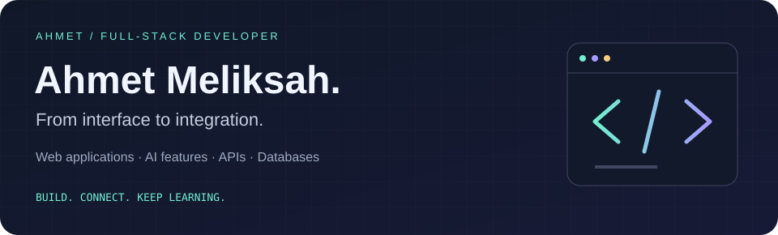
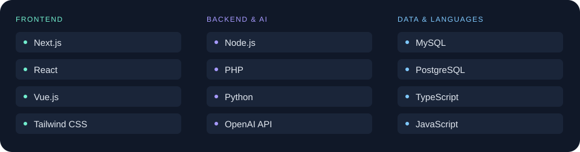
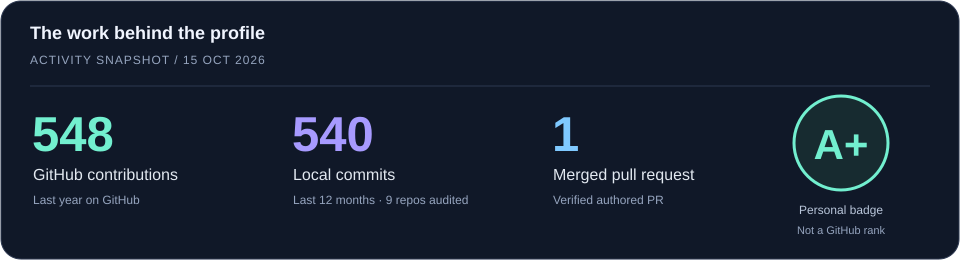

  

  
  
  
  

I build web applications from the interface through to the backend, database, and external services. My work spans **Next.js, React, Node.js, PHP, Python, and SQL**, with a focus on useful **AI features and API integrations**.

### 01 / What I build

| Web applications | AI & integrations | Backend & data |
| :--- | :--- | :--- |
| Interfaces and complete application flows with React, Next.js, and Vue. | AI summaries, reply drafting, and connections to third-party APIs. | Server-side logic and database-backed features with MySQL and PostgreSQL. |

### 02 / The toolkit

**Also in the mix:** HTML · CSS · SQL · Git · GitHub · Figma · shadcn/ui

### 03 / Selected work

<table>
<tr>
<td width="50%" valign="top">
<h3>✦ Relay</h3>

<strong>AI Support Copilot</strong>

A support inbox demo that turns fictional customer conversations into AI summaries and draft replies through a server-side OpenAI integration.

<code>Next.js</code> <code>TypeScript</code> <code>OpenAI</code> <code>Tailwind</code>

<a href="https://github.com/aahmetmeliksah/ai-support-copilot"><strong>Explore the project →</strong></a>

Portfolio demo; replies remain local.
</td>
<td width="50%" valign="top">
<h3>↗ Full-stack E-commerce</h3>

<strong>From product API to storefront</strong>

A bootcamp project with API-driven listings, product detail views, and product creation and deletion across a Vue frontend and Node backend.

<code>Vue.js</code> <code>Node.js</code> <code>PostgreSQL</code> <code>APIs</code>

<a href="https://github.com/aahmetmeliksah/e-commerce1"><strong>Explore the project →</strong></a>

Full-stack bootcamp project.
</td>
</tr>
</table>

### 04 / Development activity

Behind the numbers

- **548 contributions:** GitHub profile graph for the last year, observed October 15, 2026.
- **540 local commits:** October 15, 2025–October 15, 2026, attributed to my Git email addresses across nine local repositories and deduplicated by commit SHA.
- **1 merged PR:** verified in GitHub's authenticated authored-PR search on October 15, 2026.
- These are **dated snapshots**, including work that public-only widgets can miss. Local commits and GitHub contributions are different measures; they should not be added together.
- **A+** is a personal badge for this profile, not an official GitHub score or percentile.

---

<strong>Build, learn, train, repeat.</strong> Away from the keyboard: Muay Thai and bodyweight workouts.

<a href="mailto:aahmetmeliksah@gmail.com">aahmetmeliksah@gmail.com</a>

